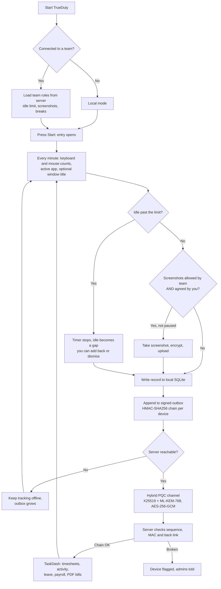
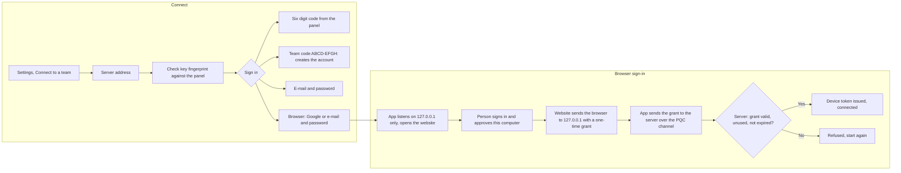

# TrueDuty

Open source time and activity tracker for Windows, macOS and Linux. It works on its own (local mode) and can connect to a [TaskDash](https://github.com/QudsLab/TaskDash) team for timesheets, leave, payroll and team reports.

- Local first: tracks with no server and no account.
- Private by default: screenshots are off unless the team allows them **and** you agree.
- Tamper evident: offline records are chained and signed per device.
- Post-quantum channel: X25519 + ML-KEM-768 with AES-256-GCM and a pinned server key.

## Download

Get the latest build from [Releases](https://github.com/QudsLab/TrueDuty/releases/latest).

| System | CPU | Installer | Portable |
|---|---|---|---|
| Windows 10/11 | x64 (Intel, AMD) | `TrueDuty-<v>-windows-x64.msi` or `TrueDuty-Setup-<v>-windows-x64.exe` | `TrueDuty-<v>-windows-x64-portable.zip` |
| Windows 11 | ARM64 (Snapdragon) | `TrueDuty-<v>-windows-arm64.msi` or `TrueDuty-Setup-<v>-windows-arm64.exe` | `TrueDuty-<v>-windows-arm64-portable.zip` |
| macOS 12+ | Apple silicon | `TrueDuty-<v>-macos-arm64.dmg` or `.pkg` | `TrueDuty-<v>-macos-arm64-portable.zip` |
| macOS 12+ | Intel | `TrueDuty-<v>-macos-x64.dmg` or `.pkg` | `TrueDuty-<v>-macos-x64-portable.zip` |
| Linux (Debian, Ubuntu, Mint) | x64 / ARM64 | `trueduty_<v>_amd64.deb` / `_arm64.deb` | `TrueDuty-<v>-linux-<arch>-portable.tar.gz` |
| Linux (Fedora, RHEL, openSUSE) | x64 / ARM64 | `trueduty-<v>.x86_64.rpm` / `.aarch64.rpm` | same |
| Any Linux | x64 / ARM64 | `TrueDuty-<v>-linux-<arch>.AppImage` (single file) | same |

The `.msi` is the standard Windows Installer package: double-click it, or deploy it silently with `msiexec /i TrueDuty-<v>-windows-x64.msi /qn` (Intune, GPO, SCCM). It installs to Program Files, adds Start menu and desktop shortcuts, upgrades older versions in place and uninstalls from Apps and features. Use either the `.msi` or the Setup `.exe`, not both.

Installers keep data in `%APPDATA%\trueduty` or `~/.config/trueduty`. Portable builds keep everything in a `TrueDuty-data` folder next to the app and leave nothing behind; any build becomes portable when a file named `portable` sits next to it.

### Trust and verification

Builds are standalone folders (no self-extracting one-file exe, the usual antivirus false positive), installed by normal installers, with full version metadata. Every file has a Sigstore build provenance attestation and a SHA-256 checksum; Windows Authenticode, Apple notarization, GPG and VirusTotal reports turn on as soon as their secrets are set. Setup and options: [docs/code-signing.md](docs/code-signing.md).

```
sha256sum -c SHA256SUMS.txt --ignore-missing
gh attestation verify <file> --repo QudsLab/TrueDuty
```

## How it works





## Repository layout

```
app/                  Desktop tracker (Python, customtkinter)        python app/main.py
app/build.py          Nuitka standalone build (folder, .app on macOS)
app/packaging/        Installers and portable packages per OS, Windows signing helper
mobile/               Notes for the Android PWA / TWA wrapper          the page is served by TaskDash at /m
docs/                 Update plan for the app
.github/workflows/    Build, package, sign and release
```

The server, website and web panel live in the TaskDash repository.

## Run from source

```
cd app
pip install -r requirements.txt
python main.py
```

Linux needs `python3-tk`; window titles on X11 need `xdotool`.

## Local mode

With no server connected TrueDuty still tracks: projects you add in Settings, activity per minute: key presses, clicks, scroll steps, pointer moves, pointer distance and the seconds that had any input (counts only, never which keys), the active app and, if you allow it, window titles. Insights shows day, week, month, year and any custom range. Nothing leaves the computer.

## Connected mode

Settings, Connect to a team. Type the server address, check the key fingerprint against the panel, then sign in:

- Browser (default): the website opens, you sign in with Google or your e-mail and password and approve the computer. The website hands a one-time grant to TrueDuty through `http://127.0.0.1:<port>/callback` on your own computer; TrueDuty sends it to the server, which checks that it belongs to this sign-in, is unused and not expired, then issues the device token. A grant works once.
- Six digit code from the panel, a team code (creates your account), or e-mail and password typed in the app.

### Offline and the signed log

With no network TrueDuty keeps tracking and checks for the server every 15 seconds (backing off to 2 minutes). When the connection is back, everything waiting is uploaded in order. A record leaves the outbox only after the server confirms it was stored; idle minutes are marked, never deleted.

Every record (entries, activity minutes, breaks, idle gaps) is written to a local outbox chained by HMAC-SHA256 with a key only this device and the server know. When the server is unreachable the app keeps tracking. On sync the server accepts records only in sequence and only when each one's MAC and back link match. Deleting, editing or reordering records breaks the chain; the server then marks the device and tells the admins. This makes tampering detectable, not impossible: someone with full control of the machine can still choose not to run the app.

The device key and token are wrapped with Windows DPAPI on Windows. On macOS and Linux the config file is readable only by your user.

### Team rules the app follows

- Idle: after the team's idle limit the timer stops. Default rule "start from the max point": time up to the limit counts, the rest becomes a gap you can add back or dismiss.
- Overtime is never blocked. The daily target only colours the ring.
- Screenshots: taken only when the team allows them and you agreed on your Privacy page in the panel. Pause for an hour from Settings (logged, admins are told). Every view of a screenshot, including your own, is logged and shown to you.
- Breaks: one click; a daily allowance only warns, it never stops you.

## Releases and signing

`.github/workflows/release.yml` runs on every push to `main` (release `v2.0.<run>`), on tags `v*` (release with that version) and by hand. It builds six targets (Windows x64/ARM64, macOS arm64/x64, Linux x64/ARM64), signs, packages, checksums, attests, optionally scans with VirusTotal and publishes. If one target fails the others are still published. Packaging scripts are in `app/packaging/`, signing setup in [docs/code-signing.md](docs/code-signing.md).

Local build: `cd app && python build.py` (output in `app/dist/`).

## License

TrueDuty is released under the [MIT License](LICENSE), copyright QudsLab. You may use, copy, change and ship it, also commercially, as long as the copyright and license notice stay with it.

Third party components bundled in the builds keep their own licenses (full list with links in [THIRD_PARTY_NOTICES.md](THIRD_PARTY_NOTICES.md)):

| Component | License |
|---|---|
| customtkinter | MIT |
| pynput | LGPL-3.0 (source is public in this repository and upstream, so the work can be rebuilt against a changed pynput) |
| Pillow | MIT-CMU (HPND) |
| cryptography | Apache-2.0 or BSD-3-Clause |
| mss | MIT |
| kyber-py | MIT |
| certifi | MPL-2.0 |
| Space Grotesk, Roboto Mono fonts | SIL Open Font License 1.1 (`app/assets/fonts/OFL.txt`) |
| Python runtime | PSF License |
| Nuitka (build tool) | Apache-2.0; compiled output is not restricted |
