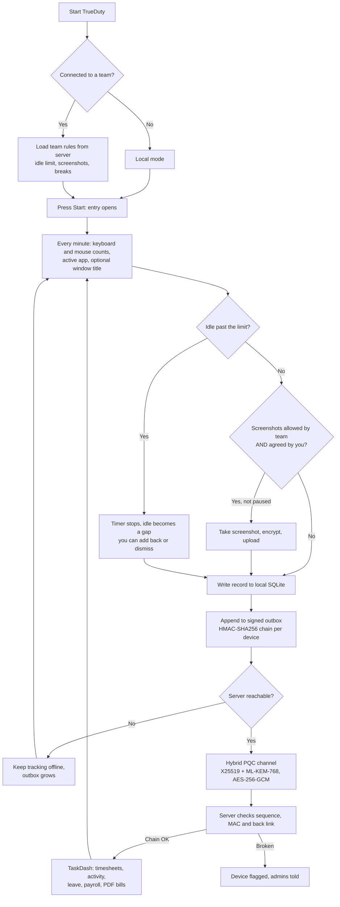
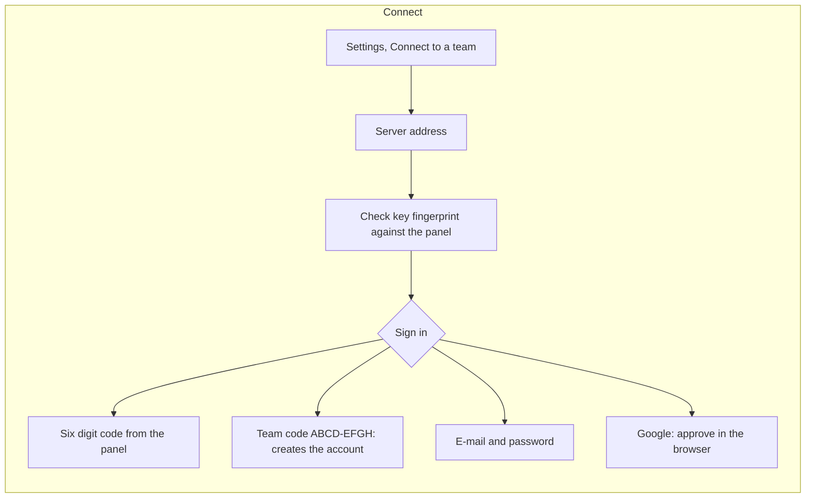

# TrueDuty

Open source time and activity tracker for Windows, macOS and Linux. It works on its own (local mode) and can connect to a [TaskDash](https://github.com/QudsLab/TaskDash) team for timesheets, leave, payroll and team reports.

- Local first: tracks with no server and no account.
- Private by default: screenshots are off unless the team allows them **and** you agree.
- Tamper evident: offline records are chained and signed per device.
- Post-quantum channel: X25519 + ML-KEM-768 with AES-256-GCM and a pinned server key.

## Download

Get the latest build from [Releases](https://github.com/QudsLab/TrueDuty/releases/latest). Every system has two versions:

| System | Installer | Portable |
|---|---|---|
| Windows 10/11 x64 | `TrueDuty-Setup-<v>-windows-x64.exe` (Start menu, optional autostart, uninstaller) | `TrueDuty-<v>-windows-x64-portable.exe` |
| macOS (Apple silicon, Intel) | `TrueDuty-<v>-macos-<arch>.dmg` (drag to Applications) | `TrueDuty-<v>-macos-<arch>-portable.zip` |
| Linux x64 | `trueduty_<v>_amd64-linux.deb` (`sudo apt install ./trueduty_*.deb`) | `TrueDuty-<v>-linux-x64-portable` (`chmod +x`, run) |

The **installer** keeps data in `%APPDATA%\trueduty` (Windows) or `~/.config/trueduty`.
The **portable** build keeps everything in a `TrueDuty-data` folder next to itself, so it runs from any folder or USB stick and leaves nothing behind. Any build becomes portable when a file named `portable` sits next to it.

### Verify a download

```
sha256sum -c SHA256SUMS.txt --ignore-missing          # checksum
gh attestation verify <file> --repo QudsLab/TrueDuty   # signed build record (Sigstore)
gpg --verify <file>.asc <file>                         # when the release has .asc files
```

Every file carries a GitHub build provenance attestation, which proves it was built by this repository's workflow from a given commit. Windows Authenticode, macOS Developer ID with notarization and GPG signatures are added automatically once the signing secrets are set (see [Releases and signing](#releases-and-signing)).

## How it works





## Repository layout

```
app/                  Desktop tracker (Python, customtkinter)        python app/main.py
app/build.py          Nuitka build (one file on Windows and Linux, .app on macOS)
app/packaging/        Windows installer script (Inno Setup)
mobile/               Notes for the Android PWA / TWA wrapper          the page is served by TaskDash at /m
docs/                 Update plan for the app
.github/workflows/    Build, package, sign and release
```

The server, website and web panel live in the TaskDash repository.

## Run from source

```
cd app
pip install -r requirements.txt
python main.py
```

Linux needs `python3-tk`; window titles on X11 need `xdotool`.

## Local mode

With no server connected TrueDuty still tracks: projects you add in Settings, activity per minute (keyboard and mouse event counts, never the keys), the active app and, if you allow it, window titles. Insights shows day, week, month, year and any custom range. Nothing leaves the computer.

## Connected mode

Settings, Connect to a team. Type the server address, check the key fingerprint against the panel, then sign in with a six digit code, a team code, your password or Google.

### Offline and the signed log

Every record (entries, activity minutes, breaks, idle gaps) is written to a local outbox chained by HMAC-SHA256 with a key only this device and the server know. When the server is unreachable the app keeps tracking. On sync the server accepts records only in sequence and only when each one's MAC and back link match. Deleting, editing or reordering records breaks the chain; the server then marks the device and tells the admins. This makes tampering detectable, not impossible: someone with full control of the machine can still choose not to run the app.

The device key and token are wrapped with Windows DPAPI on Windows. On macOS and Linux the config file is readable only by your user.

### Team rules the app follows

- Idle: after the team's idle limit the timer stops. Default rule "start from the max point": time up to the limit counts, the rest becomes a gap you can add back or dismiss.
- Overtime is never blocked. The daily target only colours the ring.
- Screenshots: taken only when the team allows them and you agreed on your Privacy page in the panel. Pause for an hour from Settings (logged, admins are told). Every view of a screenshot, including your own, is logged and shown to you.
- Breaks: one click; a daily allowance only warns, it never stops you.

## Releases and signing

`.github/workflows/release.yml` runs on every push to `main`, on tags `v*` and by hand from the Actions tab.

| Trigger | Release |
|---|---|
| Push to `main` | `v2.0.<run number>` |
| Tag `v1.4.0` | `v1.4.0` |

For each run it builds Windows x64, macOS Apple silicon, macOS Intel and Linux x64 with Nuitka, packages installer and portable versions, writes `.sha256` files and `SHA256SUMS.txt`, attests every file and publishes the release. TaskDash's download page lists new releases by itself. If one system fails, the others are still published.

Platform code signing turns on when these repository secrets exist (Settings, Secrets and variables, Actions):

| Secret | Used for |
|---|---|
| `WIN_CERT_PFX_BASE64`, `WIN_CERT_PASSWORD` | Authenticode for the exe and the installer (removes most SmartScreen warnings) |
| `MAC_CERT_P12_BASE64`, `MAC_CERT_PASSWORD`, `MAC_IDENTITY` | Developer ID signing of the app and the dmg |
| `APPLE_ID`, `APPLE_TEAM_ID`, `APPLE_APP_PASSWORD` | Notarization and stapling (no Gatekeeper prompt) |
| `GPG_PRIVATE_KEY`, `GPG_PASSPHRASE` | Detached `.asc` signatures for every file |

Without the Apple secrets the macOS app is ad hoc signed; open it the first time with right click, Open.

Local build: `cd app && python build.py`.

## License

TrueDuty is released under the [MIT License](LICENSE), copyright QudsLab. You may use, copy, change and ship it, also commercially, as long as the copyright and license notice stay with it.

Third party components bundled in the builds keep their own licenses:

| Component | License |
|---|---|
| customtkinter | MIT |
| pynput | LGPL-3.0 (source is public in this repository and upstream, so the work can be rebuilt against a changed pynput) |
| Pillow | MIT-CMU (HPND) |
| cryptography | Apache-2.0 or BSD-3-Clause |
| mss | MIT |
| kyber-py | MIT |
| certifi | MPL-2.0 |
| Space Grotesk, Roboto Mono fonts | SIL Open Font License 1.1 (`app/assets/fonts/OFL.txt`) |
| Python runtime | PSF License |
| Nuitka (build tool) | Apache-2.0; compiled output is not restricted |
